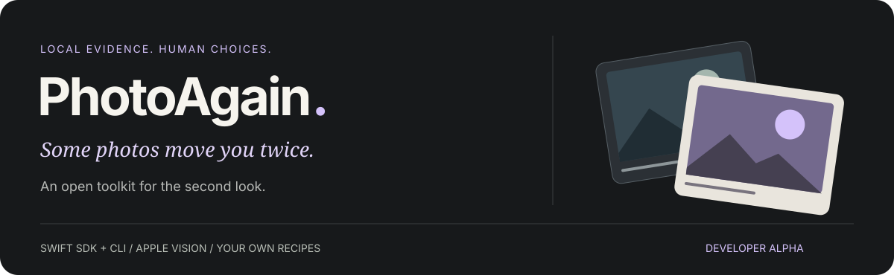
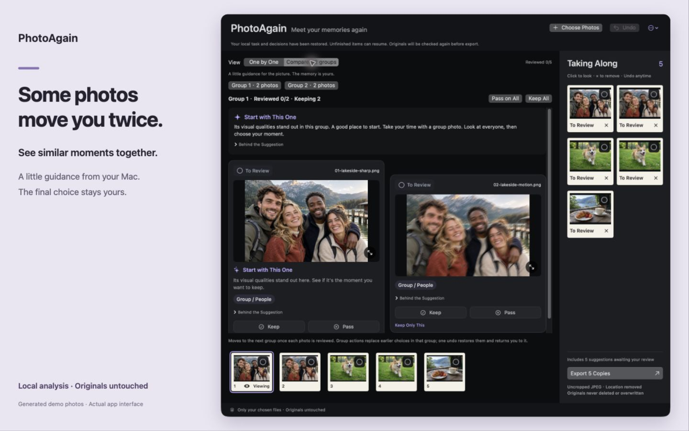

# PhotoAgain · 照面



**Some photos move you twice. Help build the second look.**

A local-first Swift toolkit for AI-assisted photo selection. Explore what makes a photo worth keeping, build your own selection policy, and compare the results without giving a model the last word.

**Developer alpha** · **macOS 14+ / Swift 6** · **Apache-2.0 + DCO**

[中文](README.zh-CN.md) · [Quick start](docs/QUICKSTART.md) · [Contribute](CONTRIBUTING.md) · [Local models](docs/LOCAL-MODELS.md) · [Project page source / local preview](docs/site/index.html)

## Two ways to take a second look

| For builders — this repository | For everyone — Mac app coming soon |
|---|---|
| Swift libraries and a CLI. Inspect native Vision evidence, change a selection recipe, try an optional local-model adapter, and evaluate your own ideas. | **PhotoAgain / 照面**, a **free** Mac app for comparing photos, choosing what to take along, and exporting sharing copies. |
| Source available under Apache-2.0; no bundled model weights. | A separate application. Its UI, export workflow and complete selection implementation are not included in this SDK. |



*Actual Mac app interface with generated fictional demo photos. This illustrates the app workflow, not a real-photo quality benchmark or framework/App algorithm parity. The app is coming soon; no release date or live download is promised. [Image rights](docs/site/assets/RIGHTS.md).*

## Try the framework in a few minutes

With a Swift 6 toolchain on macOS:

```sh
git clone https://github.com/argvid-ai/PhotoAgain.git
cd PhotoAgain
```

From the repository root:

```sh
swift test
swift run photoagain demo --output /tmp/photoagain-first-demo
```

Use a new output directory. The demo creates its own geometric images: **no photo-library permission, private photos, account, or model download required**. Native aesthetics needs macOS 15+; missing signals are reported and the policy can abstain.

Then try an explicit batch you choose:

```sh
swift run photoagain analyze --input ./my-test-images --output ./evidence.json
swift run photoagain recommend --input ./evidence.json --recipe ./Examples/keep-variety.json --output ./recommendations.json
```

[Complete commands, formats, limits and decision-ledger example →](docs/QUICKSTART.md)

## What you can build today

| Start here | Change | Inspect |
|---|---|---|
| **A selection recipe** | Representative vs. variety, desired count, abstention margin | What gets suggested, what remains uncertain, and what the person explicitly keeps |
| **A native evidence workflow** | Use the Vision reference analyzer on selected JPEG/PNG/HEIC files | Aesthetic evidence, face count/capture quality and experimental similarity groups |
| **A local-model experiment** | Opt in to the Ollama adapter for 2–4 images | Typed regions worth checking, separate from native ranking and human decisions |
| **A reproducible evaluation** | Compare one concrete task across recorded conditions | Important misses, correction time, latency and memory—not only a model score |

```text
chosen files → native evidence → your recipe → suggestions + reasons
                                                 ↕
                                     explicit keep / exclude / undo

optional local-model hints ──────────── separate advice, never a decision
```

`PhotoAgainCore` owns the contracts and policy; `PhotoAgainVision` supplies native evidence; `PhotoAgainOllama` is optional. The native workflow has no network dependency. The adapter sends reduced, metadata-stripped previews to a user-controlled localhost runtime only after explicit acknowledgement; localhost alone does not prove the runtime stays offline.

## A result you can inspect

Our [checked-in native demo](Examples/native-demo/README.md) contains the generated inputs and actual JSON from a recorded run: **3 images → 1 experimental group → abstention because the scores are close**. It is useful precisely because it exposes uncertainty instead of inventing a confident winner.

This is a plumbing example, not proof of photographic taste. Native scores depend on the OS; real-photo usefulness and target-Mac performance remain to be measured. Optional-model tests use a mock transport; **no real-model compatibility is claimed yet**. [Evaluation guide →](docs/EVALUATION.md)

## Make one part better

We welcome photographers, Mac developers, ML experimenters and people who have a clear idea of what a tool should *not* discard.

- **Bring one reproducible failure.** Use generated or clearly licensed fixtures; show the expected outcome and the observed result. A good failure can be more useful than another model integration.
- **Improve a selection rule.** Start with a recipe. For code changes, preserve explicit choices and show the tradeoff on the same inputs.
- **Test a real local model.** Record the exact model/digest, runtime, resource costs and misleading hints. Do not upload private media or raw runtime logs.
- **Make the first five minutes easier.** Improve examples, translations, accessibility of documentation or error explanations.

Small fixes can go straight to a PR. Discuss new runtimes, schema changes and larger features before building them. [Starter tasks and acceptance criteria](docs/CONTRIBUTION-IDEAS.md) · [Contribution guide](CONTRIBUTING.md)

## Trust is part of the interface

The CLI reads only explicitly chosen files or a bounded flat directory. It does not scan Photos, overwrite originals, delete images or write albums. Public evidence omits source paths and image bytes; a separately requested private map stays local. Evidence may still be sensitive in context: inspect it before sharing.

An unclicked recommendation is **not** a rejection. Missing evidence is **not** a zero score. A new batch cannot inherit another batch's decisions. [Contracts](docs/CONTRACTS.md) · [Privacy and product boundaries](docs/BOUNDARIES.md)

## License, contributions and independence

Code and documentation use [Apache-2.0](LICENSE). Commercial use and forks are welcome. Contributors retain copyright and certify the right to submit through [DCO 1.1](DCO); there is no copyright-assignment requirement or broad CLA. Model weights, datasets, system components and the identified App promotional images have separate terms. [Rights inventory](docs/RIGHTS.md) · [Brand policy](TRADEMARKS.md) · [Governance](GOVERNANCE.md)

PhotoAgain is independently maintained at [argvid-ai/PhotoAgain](https://github.com/argvid-ai/PhotoAgain). It does not depend on, integrate with, or claim protocol compatibility with the evolving [Argvid framework](https://github.com/argvid-ai/argvid).

**Current scope:** SDK + CLI alpha. No library integration, GUI, video, export pipeline, learned preferences, stable SDK guarantee, or published real-world performance claim in this repository. The conservative variety policy and other known limits are documented in the [quick start](docs/QUICKSTART.md).
