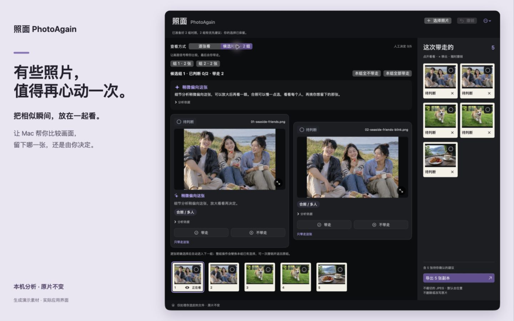

# PhotoAgain · 照面

**照片让人感动两次：一次是按下快门，一次是再次照面。**

PhotoAgain 是面向 AI 选片实验的本地 Swift 工具包。用 Mac 的 Vision 生成依据，修改自己的选片策略，比较不同方法；最终决定留给看照片的人。

[English](README.md) · [首页预览](docs/site/index.html) · [运行指南](docs/QUICKSTART.md) · [参与贡献](CONTRIBUTING.md)

## 开发者工具包与免费 Mac App

**这个仓库：** Swift SDK + CLI，开发者 Alpha 阶段，采用 Apache-2.0。你可以运行示例、修改策略、接入可选本地模型、搭建自己的评测或产品。

**即将上线：** 同名免费 Mac App「照面 PhotoAgain」，帮助你对照相似照片、确认带走哪些，并导出分享副本。App 独立开发；本仓库不包含完整 App，也不声称算法完全相同。具体上线时间尚未公布。



*实际 App 界面，使用生成的虚构示例照片；不是私人相册或真实效果评测。[展示图使用边界](docs/site/assets/RIGHTS.md)。*

## 先跑起来，再改一个想法

在 macOS 14+、Swift 6 环境下：

```sh
git clone https://github.com/argvid-ai/PhotoAgain.git
cd PhotoAgain
```

然后在仓库根目录执行：

```sh
swift test
swift run photoagain demo --output /tmp/photoagain-first-demo
```

输出目录必须尚不存在。程序自己生成几何图片，无需相册授权、账号或下载模型。原生美学分析需要 macOS 15+；信号缺失时会明确记录，策略可能放弃自动推荐。

| 你想试什么 | 现有入口 | 要证明什么 |
|---|---|---|
| 同一组照片，换一种选法 | `representative` / `keep-variety` recipe | 是否减少遗漏与纠正成本 |
| 看懂推荐来自哪里 | Vision evidence JSON | 什么被测到了，什么仍然未知 |
| 用自己的本地模型辅助对照 | 可选 Ollama `group-hints` | 提醒是否正确、有用，而非只会输出合法 JSON |
| 为自己的工作流做工具 | Swift contracts + CLI | 在不改用户选择的前提下复用依据与策略 |

Ollama 是用户主动配置的可选项，只将缩小、去元数据的预览发给本机固定端口；本机端口不能保证该服务不会再联网。当前只通过模拟传输测试，尚未完成真实模型兼容性验证。

[本次真实运行的几何示例](Examples/native-demo/README.md)：3 张图形成 1 个实验性分组，因为分数接近而不自动选胜者。这验证管线和不确定性表达，不证明真实照片选得好。真实照片、HEIC 样本及 M3 16 GB 上的质量/性能仍需专项验证。

## 欢迎贡献一个具体改进

1. 给出可复现的失败：采用自有、生成或许可清楚的样本，不上传家庭私照。
2. 改一个选片规则：记录输入、目标、版本、结果与代价。
3. 评测一个本地模型：记录正确提醒、误导提醒、耗时和内存。
4. 改善入门文档与错误说明，让下一位开发者更容易上手。

小修直接 PR，较大功能先讨论。我们关心保留重要照片、减少操作负担，也关心可靠的反例。[贡献任务](docs/CONTRIBUTION-IDEAS.md) · [评测方法](docs/EVALUATION.md)

## 权利与边界

- 代码和文档采用 Apache-2.0，允许商业复用及竞争产品；保留许可证要求的声明。
- DCO 签署确认你有权提交，**不转让贡献者的版权**，不要求宽泛 CLA。
- 权重、数据、系统组件与指定 App 宣传截图分别审查，不因代码开源而自动开放。
- CLI 不扫描系统相册、不覆盖原片、不删图、不写入相册；公共 JSON 不包含源路径或照片字节，分享前仍需检查敏感含义。
- PhotoAgain 暂不接入 Argvid 整体框架；独立运行，不承诺协议兼容。App 的 UI、导出、个性化等能力也不等于这个 Alpha 已具备。

[LICENSE](LICENSE) · [DCO](DCO) · [权利说明](docs/RIGHTS.md) · [治理](GOVERNANCE.md)
